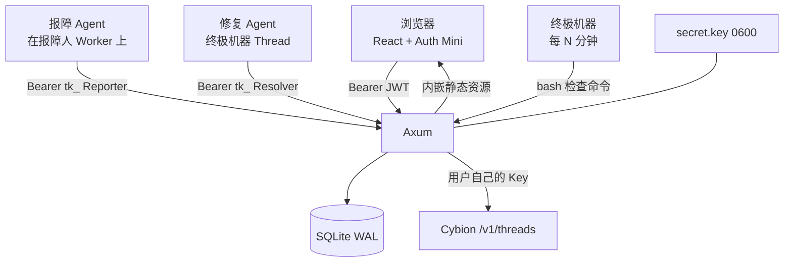
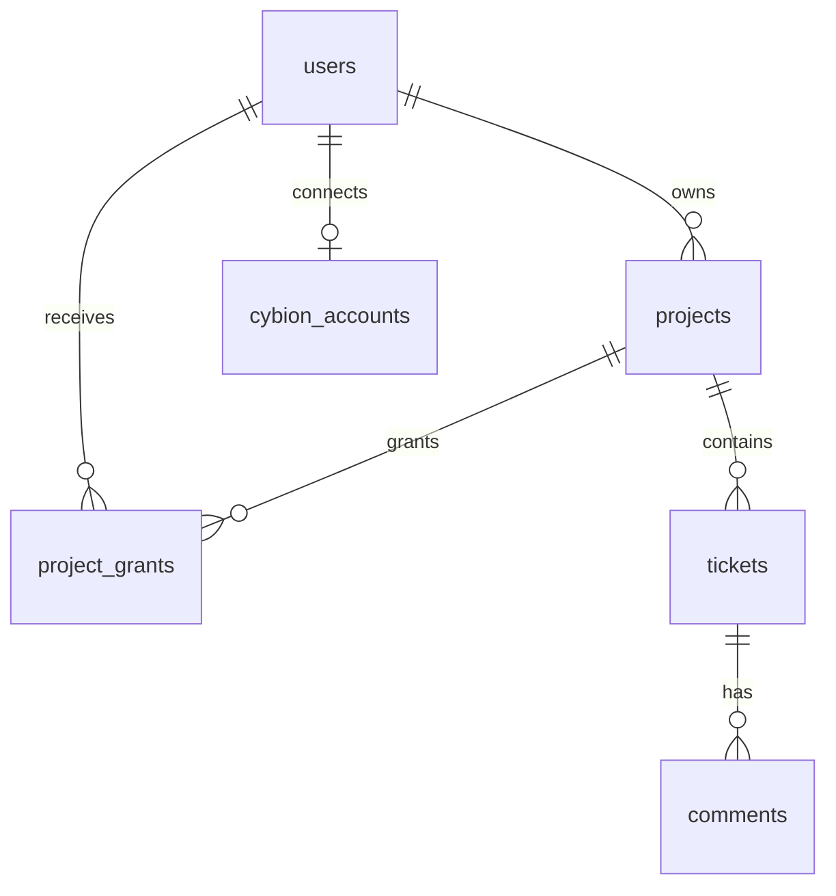
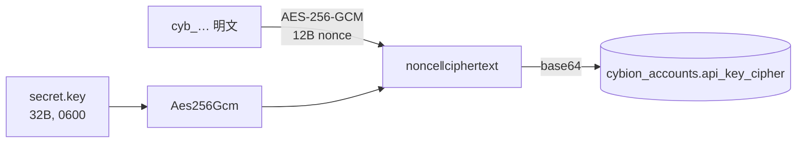
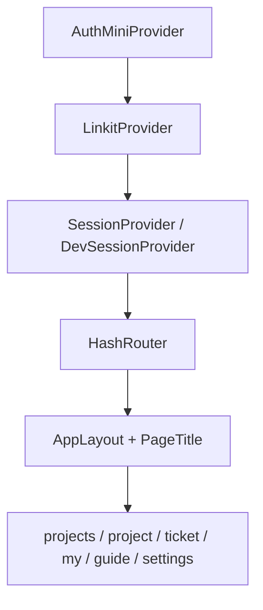
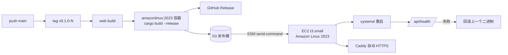

# Tickets 技术设计

**结论：一个 Rust 单二进制同时提供 API 与前端，SQLite 存全部状态；身份来自 Auth Mini，Agent 身份来自两种 `tk_` 令牌；Cybion 的三次调用（建 Thread、投简报、读 Thread）全部用报障人自己的加密 Key 完成。**

## 架构



一条请求只会落在三种入口之一：

| 入口 | 中间件 | 身份 |
| --- | --- | --- |
| `/api/health`、`/api/meta` | 无 | 公开 |
| `/api/*` 其余浏览器路由 | `require_user` | Auth Mini JWT，或 `--dev-user` |
| `/api/agent/*` | `require_agent` | `tk_` 令牌 → 作用域 |
| 其他路径 | `web::static_handler` | 内嵌前端，未知路径回落到 `index.html` |

## 技术选型

| 选择 | 原因 |
| --- | --- |
| Rust + Axum | 单二进制、启动快、类型安全的请求处理；和家族其他服务的部署方式一致。 |
| SQLite（sqlx） | 数据量小、单实例、事务够用；WAL 让读写不互相阻塞。 |
| `rust-embed` | 前端打进二进制，部署只需要一个文件，版本不会错配。 |
| React + Vite + Tailwind 4 + shadcn | 家族前端标准；`@zccz14/ux` 提供布局、导航与主题一致性。 |
| 常量字典 i18n | 构建期保证中英键完整，不需要运行时加载翻译文件。 |
| 无 Docker、无环境变量 | 发布物是二进制，配置在 SQLite 的 `settings` 表里。 |

## 数据模型



| 表 | 作用 | 关键列 |
| --- | --- | --- |
| `users` | Auth Mini 主体缓存 | `id`、`display_name`（来自 Linkit 的 `X-Linkit-Username`） |
| `cybion_accounts` | 每人一把加密的 Cybion Key | `api_key_cipher`、`key_hint` |
| `projects` | 队列、所有者与可见性 | `visibility`（`public`/`private`）、`ticket_counter`、`resolver_key_hash`、`resolver_thread_url` |
| `project_grants` | 私有项目的授权成员 | `(project_id, user_id)` 主键；成员从 Linkit 目录挑选，只存 `user_id` |
| `tickets` | 工单与两侧水位 | `status`、`last_reporter_at`、`last_resolver_at`、`reporter_thread_*` |
| `comments` | 时间线 | `kind`（`comment`/`evidence`/`system`）、`author_kind` |

三个实现细节：

1. **编号是事务内自增的**。创建工单时先 `UPDATE projects SET ticket_counter=ticket_counter+1 … RETURNING ticket_counter`，再插入工单，两步在同一个事务里；`UNIQUE(project_id, number)` 是兜底。并发创建不会拿到相同编号，也不会串号。
2. **水位在写评论时一起更新**。`insert_comment` 按作者类型决定抬 `last_reporter_at` 还是 `last_resolver_at`，与插入评论同一条语句完成，队列判据因此永远和评论一致。
3. **索引围绕三个查询**：项目内状态列表（`project_id, status, updated_at DESC`）、我的工单（`reporter_user_id, updated_at DESC`）、队列（`project_id, status, last_resolver_at, last_reporter_at`）。

用户评论还会顺手推进报障侧的 Thread：`comment` handler 先落库再 `tokio::spawn` 一个 `progress_reporter_thread`，由它确保 Thread 存在、用报障人的 Key 投一条带评论内容的 input。评论的 HTTP 响应不等 Cybion；推进失败只写 `reporter_thread_error`，评论本身已经成功。

数据库连接：WAL、`synchronous=NORMAL`、`foreign_keys=ON`、`busy_timeout=10s`、连接池 8。建表用 `CREATE TABLE IF NOT EXISTS`；当前没有迁移框架，改列需要手写迁移脚本。

## 认证与授权

### 浏览器

`AuthGate` 懒加载 Auth Mini 的 JWKS：第一次需要校验时才去取，取到后缓存在进程内。这样 Auth Mini 短暂不可用不会阻止进程启动或发布，只是登录请求会收到 503。

`--dev-user` 把整条校验替换成固定用户，并在启动时打 WARN。前端对应的 `DevSessionProvider` 被 `import.meta.env.DEV` 包住，生产构建里这段代码不可达。

### 项目可见性

`visibility` 与 `project_grants` 一起决定谁能看到一个项目：

- `projects::require_view` 是唯一的闸门：owner 恒通过，`public` 恒通过，`private` 还要在 `project_grants` 里有行。所有项目与工单的浏览器接口（列表、详情、建单、评论、提交、关单、Thread）都先过这道闸门，隐藏的项目统一回 404 而不是 403，避免泄露存在性。
- 列表查询把同一条规则写进 SQL：`visibility='public' OR owner_user_id=? OR EXISTS(project_grants …)`；`/api/me/tickets` 用同样的过滤，所以失去授权后连自己的旧工单也不再出现。
- 授权管理（`/api/projects/{id}/grants`）先过 `require_view` 再过 owner 检查：公开项目上的非所有者得到 403，私有项目上的非成员得到 404。
- Resolver 的 `owned_project` 也先过 `require_view`，但归属不变：修复密钥、终极机器与队列仍然只属于 owner，授权成员拿不到。
- 迁移：`visibility` 用 `ALTER TABLE … DEFAULT 'public'` 加到存量库，因此老项目保持所有人可见；新库的建表默认值是 `private`，应用层插入时总是显式绑定。

### Agent 令牌

```
tk_ + 24 字节随机数的 hex（共 51 字符）
```

服务端只存 `SHA-256` 与一个 12 字符的提示，因此拖库不能伪造 Agent 调用。两种作用域在 `authorize()` 里对着工单本身校验：

- Reporter：令牌解析出的 `ticket_id` 必须等于目标工单。
- Resolver：令牌解析出的 `project_id` 必须等于目标工单的项目，且目标不能是草稿。

「证据」是额外的类型闸门：只有 Reporter 能写 `kind=evidence`，Resolver 写会被 403。

### 凭据加密



密钥文件与数据库分开放：只拿到 `tickets.db` 无法解出任何人的 Cybion Key。轮换 `secret.key` 会让已存的 Key 全部解不开，UI 会显示「需要重新连接」，这是有意的取舍。

## Cybion 集成

Cybion 的 `/v1/threads` 按 API Key 的 owner 隔离，服务端拿一把公共 Key 建出来的 Thread 属于服务端而不是报障人，报障人既看不到也跑不了。因此：

- 每个用户存一把自己的 Key（加密），Key 由服务端用用户的 Auth Mini 令牌调 Cybion `POST /api/api-keys` 铸出，界面不要求粘贴；
- 建 Thread 时用**报障人的 Key**，Thread 的 owner、Worker、上下文都归报障人；
- 读 Thread 状态同样用报障人的 Key，所以只有报障人能拿到链接，其他人只看到元信息。

三次调用都走 30 秒超时的 `reqwest`：

| 调用 | 路径 | 用途 |
| --- | --- | --- |
| `create_thread` | `POST /v1/threads` | 建 Thread，带 `title` 与 `external_ref` |
| `post_input` | `POST /v1/threads/{id}/inputs` | 投递调查简报 |
| `read_thread` | `GET /v1/threads/{id}` | 实时读状态与上下文用量 |
| `probe_key` | `GET /v1/threads/000…0` | 连接账号时验证 Key：401 才算无效 |

浏览器 API 复用同一枚令牌：前端把 `cybion.ntnl.io` 加进 Auth Mini 的 `audiences`，服务端验完自己的受众后把原始 Bearer 转发给 Cybion，代表这个人执行操作。

| 调用 | 路径 | 用途 |
| --- | --- | --- |
| `create_api_key` / `delete_api_key` | `/api/api-keys` | 连接账号时铸 Key，断开或换 Key 时吊销 |
| `list_workers` | `/api/workers` | 接入机器时选 Worker |
| `create_machine` / `read_machine` / `update_machine` / `delete_machine` / `run_machine` | `/api/machines` | 终极机器的接入、状态、暂停、立即运行与断开 |

失败分类直接面向用户：401 提示重新登录（受众缺失或令牌过期），403 提示权限不足，其他状态带上截断后的响应体。

Thread 创建发生在事务提交之后的后台任务里，因此提交工单永远不会等 Cybion。草稿不自动建 Thread，报障人在工单页点「创建调查 Thread」时才走同一条后台流程。失败写进 `tickets.reporter_thread_error`，工单照常进入队列；报障人可以在工单页重试。

## 队列与终极机器

检查命令由服务端 `machine.rs` 生成（前端不再持有密钥，也不再展示命令），项目只保存密钥哈希与 `resolver_machine_id`。命令做三件事：

1. 把密钥与 `ctl` 助手落到 `~/.tickets/`（目录 0700、密钥 0600）。之后所有请求都引用 `$K`，密钥不会出现在命令输出里，也就不会进入 Thread 的历史。
2. `GET /api/agent/queue`；为空则退出 0，什么都不打印。
3. 有工单则打印摘要并退出 1，让终极机器唤醒修复 Thread。

`machine.rs` 对项目名做单引号转义，因此项目名里出现引号、`$()` 或反引号也不会破坏命令或触发命令替换；测试会把生成的脚本交给 `bash -n` 验证语法。

## 前端



- **Provider 顺序**是硬约束：`@zccz14/ux` 的 `AppLayout` 需要 Linkit 上下文与 Router，Auth Mini 必须在最外层。
- **HashRouter**：静态资源由二进制提供，服务端不需要为前端路由做任何重写规则。
- **TanStack Query** 管请求状态；`createRequest` 统一注入 `Authorization` 与 `X-Linkit-Username`，并在 token 临近过期时刷新。
- **i18n** 是拍平的常量字典，`CopyKey` 由字典推导；`translate` 支持 `{n}` 占位符，缺键在编译期报错。
- **主题**是 Claude 暖橘：纸白底、墨色字、陶土橘主色；Reporter 与 Resolver 两条泳道分别用陶土橘与松绿，评论卡片与时间线标签沿用同一组变量。
- **用户身份统一交给 Linkit**：评论作者、报障人、设置页身份都用 `LinkitUserInfo`（头像 + 用户名 + 资料卡），服务端的 `display_name` 只在没有对应用户时兜底。

## 部署



| 项 | 选择 |
| --- | --- |
| 区域 / 机型 | 东京 `ap-northeast-1`，`t3.small` x86_64（和家族其他服务同 VPC） |
| 入口 | Caddy 监听 80/443，反代 `127.0.0.1:8080`；证书自动签发续期 |
| SSH | 不开放 22 端口，全部运维走 SSM |
| 进程 | systemd，`ProtectSystem=strict`，只有 `/opt/tickets/data` 可写 |
| 数据 | `/opt/tickets/data`（`tickets.db`、WAL、`secret.key`），发布不覆盖 |
| 构建 | 在 `amazonlinux:2023` 容器里编译，避免 CI 运行时的 glibc 比生产新 |
| 凭据 | GitHub OIDC 换临时角色，不使用长期 AK |

发布包只包含 `bin/tickets`、`tickets.service`、`Caddyfile`；实例脚本校验 sha256 后替换二进制、按内容差异同步 unit 与 Caddyfile、重启并轮询 `/api/health`，失败则恢复上一个二进制。

## 测试

| 层 | 覆盖 |
| --- | --- |
| Rust 单元 | AES-GCM 往返与错 Key、`secret.key` 权限与稳定性、令牌格式与哈希、摘要截断、作者类型 |
| Rust 集成 | 真 Axum 路由 + 临时 SQLite + 进程内假 Cybion：草稿可见性、权限矩阵、并发编号、令牌越权、队列水位与排序、Thread 创建/失败/重试、Key 加密落库 |
| 前端 | i18n 键与占位符完整性、相对时间、样式导入 |
| 集成 | 真实路由 + 假 Cybion：铸 Key、建机器、暂停、断开、评论唤醒 Thread、简报带项目描述 |
| CI | `pnpm run check`、`cargo fmt --check`、`cargo clippy -D warnings`、`cargo test`、脚本 `bash -n` |

集成测试不 mock 数据库，也不 mock 路由：请求真的走中间件、真的写 SQLite，只有 Cybion 是假的——它是唯一的外部依赖。

## 已知边界

- **单实例假设**：SQLite、进程内 JWKS 缓存、后台 Thread 创建都假定只有一个进程。水平扩展需要先换数据库与任务队列。
- **没有租约**：多台 Worker 同时跑同一个项目的终极机器时，两个修复 Thread 可能看到同一张工单；目前靠提示词纪律串行化。
- **Thread 创建有竞态**：同一张工单的两次「创建调查 Thread」并发时，可能各建一个 Thread，数据库只记住最后一个。触发条件是双击重试按钮，代价是多一个孤儿 Thread。
- **上下文用量不落库**：打开工单时实时探测，历史趋势无法查询。
- **前端是单包**：674 kB（gzip 214 kB），没有按路由拆包；在内网工具的量级下可接受。
