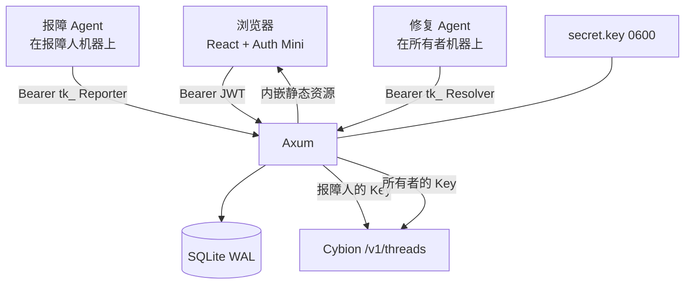
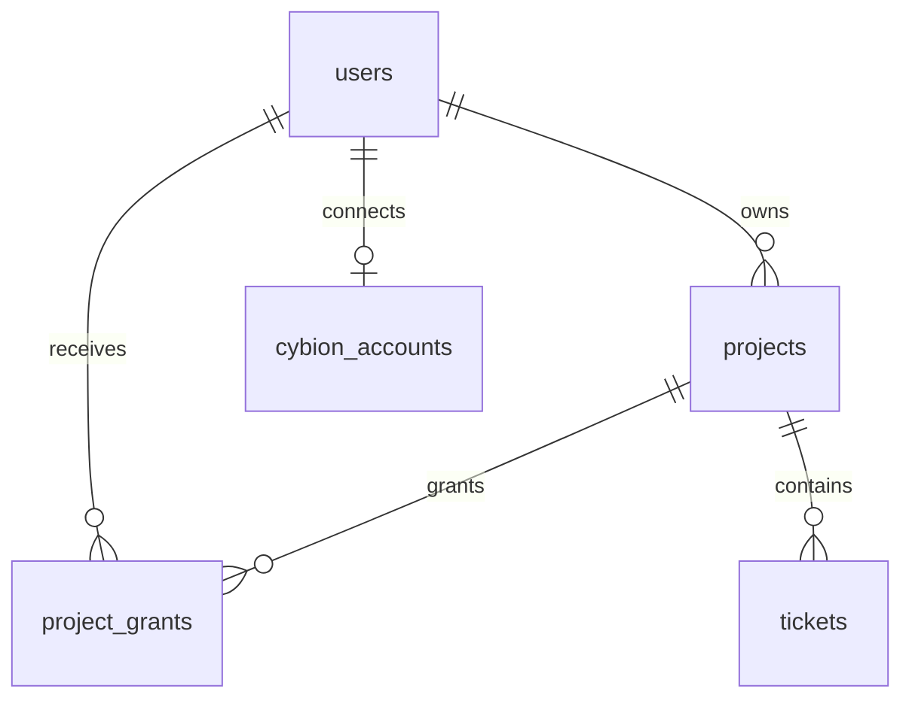
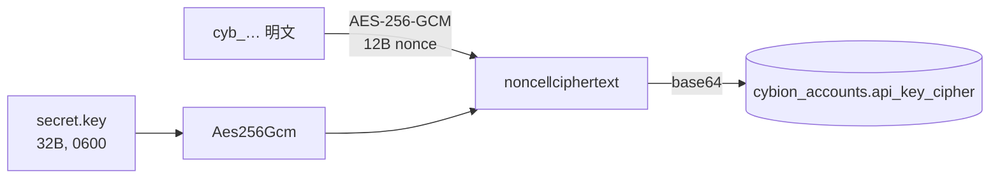
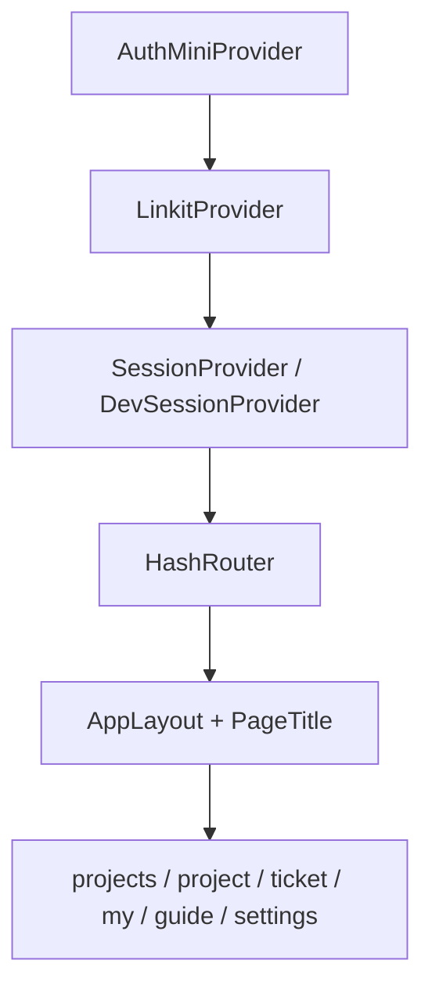
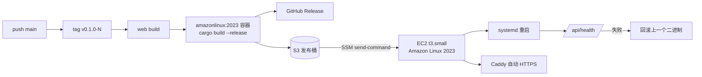

# Tickets 技术设计

**结论：一个 Rust 单二进制同时提供 API 与前端，SQLite 存全部状态；身份来自 Auth Mini，Agent 身份来自两种只绑定一张工单的 `tk_` 令牌；两侧都靠推送驱动——报障人自己的 Key 建调查 Thread，项目所有者的 Key 在提交时建修复 Thread，没有队列、没有轮询、没有定时任务。**

## 架构



一条请求只会落在三种入口之一：

| 入口 | 中间件 | 身份 |
| --- | --- | --- |
| `/api/health`、`/api/meta` | 无 | 公开 |
| `/api/*` 其余浏览器路由 | `require_user` | Auth Mini JWT，或 `--dev-user` |
| `/api/agent/*` | `require_agent` | `tk_` 令牌 → 绑定的那张工单 |
| 其他路径 | `web::static_handler` | 内嵌前端，未知路径回落到 `index.html` |

## 技术选型

| 选择 | 原因 |
| --- | --- |
| Rust + Axum | 单二进制、启动快、类型安全的请求处理；和家族其他服务的部署方式一致。 |
| SQLite（sqlx） | 数据量小、单实例、事务够用；WAL 让读写不互相阻塞。 |
| `rust-embed` | 前端打进二进制，部署只需要一个文件，版本不会错配。 |
| React + Vite + Tailwind 4 + shadcn | 家族前端标准；`@zccz14/ux` 提供布局、导航与主题一致性。 |
| 常量字典 i18n | 构建期保证中英键完整，不需要运行时加载翻译文件。 |
| 无 Docker、无环境变量 | 发布物是二进制，配置在 SQLite 的 `settings` 表里。 |

## 数据模型



| 表 | 作用 | 关键列 |
| --- | --- | --- |
| `users` | Auth Mini 主体缓存 | `id`、`display_name`（来自 Linkit 的 `X-Linkit-Username`） |
| `cybion_accounts` | 每人一把加密的 Cybion Key，报障侧和修复侧共用 | `api_key_cipher`、`key_hint`、`key_id` |
| `projects` | 队列、所有者与可见性；**没有任何修复侧配置** | `visibility`、`ticket_counter` |
| `project_grants` | 私有项目的授权成员 | `(project_id, user_id)` 主键 |
| `tickets` | 工单正文、证据、结论与两侧 Thread | `status`、`evidence`、`resolution`、`reporter_thread_*`、`resolver_thread_*` |

三个实现细节：

1. **编号是事务内自增的**。创建工单时先 `UPDATE projects SET ticket_counter=ticket_counter+1 … RETURNING ticket_counter`，再插入工单，两步在同一个事务里；`UNIQUE(project_id, number)` 是兜底。
2. **一张工单最多两张 Thread**，每张各有自己的 owner、一次性令牌（只存哈希）与错误字段：`reporter_thread_*` 与 `resolver_thread_*`。两侧令牌都只绑定这张工单，授权就是一次相等比较。
3. **索引围绕三个查询**：项目内状态列表（`project_id, status, updated_at DESC`）、我的工单（`reporter_user_id, updated_at DESC`）、授权成员（`project_grants.user_id`）。

数据库连接：WAL、`synchronous=NORMAL`、`foreign_keys=ON`、`busy_timeout=10s`、连接池 8。

## 数据库迁移

`CREATE TABLE IF NOT EXISTS` 不会改已有表，因此 `db::migrate` 逐列补齐，并主动清掉已经不属于这个模型的列与表：

- 新增：`tickets.evidence / evidence_at / resolution / resolution_at / resolver_thread_* / resolver_dispatched_at`；
- 删除：`comments` 表（评论时间线）、`tickets.last_reporter_at / last_resolver_at`（队列水位）、`projects.resolver_key_hash / resolver_key_hint / resolver_key_created_at / resolver_thread_url / resolver_machine_id`（项目级修复密钥与终极机器）。

删列前先 `DROP INDEX IF EXISTS idx_tickets_resolver`，因为它在被删的列上。删掉的内容描述的是一个已经不存在的工作方式，留着只会让代码与库各说各话。

## 认证与授权

### 浏览器

`AuthGate` 懒加载 Auth Mini 的 JWKS：第一次需要校验时才去取，取到后缓存在进程内。这样 Auth Mini 短暂不可用不会阻止进程启动或发布，只是登录请求会收到 503。

`--dev-user` 把整条校验替换成固定用户，并在启动时打 WARN。前端对应的 `DevSessionProvider` 被 `import.meta.env.DEV` 包住，生产构建里这段代码不可达。

### Agent 令牌

```
tk_ + 24 字节随机数的 hex（共 51 字符）
```

服务端只存 `SHA-256` 与一个 12 字符的提示，因此拖库不能伪造 Agent 调用。`require_agent` 先在 `tickets.reporter_agent_token_hash` 里找，再在 `tickets.resolver_agent_token_hash` 里找，两个作用域都只带一个 `ticket_id`：

- Reporter：`ticket_id` 必须等于目标工单；只能写 `evidence`。
- Resolver：同上；只能写 `resolve`（写结论 + 关单），且草稿工单直接 409。

没有项目级作用域，因为没有队列可读。

### 现场调查的实时视图

工单页的现场调查面板走三条浏览器接口，全部只对报障人开放：

| 接口 | 作用 | Cybion 调用 |
| --- | --- | --- |
| `GET /api/tickets/{id}/thread/live?after=N` | 增量历史 + 进行中的回复 | `GET /api/threads/{id}/history?after=N`、`GET /api/threads/{id}/response` |
| `POST /api/tickets/{id}/thread/live` | 报障人直接对 Agent 说话 | `POST /api/threads/{id}/inputs` |

- **身份**：Tickets 不透传自己的服务身份，而是把这次浏览器请求的 Auth Mini 访问令牌原样转给 Cybion；Thread 的 owner 是报障人，所以只有报障人的令牌读得到。项目所有者访问 live 接口得到 403。
- **增量**：前端保存已见记录的最大 `id`，下一次只取更大的记录；进行中的回复单独读 `/response`。
- **上下文注入**：简报与派单文本走 `POST /v1/threads/{id}/context`，Cybion 存成 activity 记录、回放为 developer 消息，对话里默认折叠；随后把正文作为第一条 input 投进去，推理由它启动；推进会话仍是 input，因为它必须唤醒下一轮。
- **草稿**：`live` 首次读取时若工单是草稿且没有 Thread、也没有历史错误，会调用 `ensure_reporter_thread`，把「打开草稿」变成「开始调查」；失败会记录错误，因此不会在轮询里反复重试。

### 项目可见性

`visibility` 与 `project_grants` 一起决定谁能看到一个项目：

- `projects::require_view` 是唯一的闸门：owner 恒通过，`public` 恒通过，`private` 还要在 `project_grants` 里有行。隐藏的项目统一回 404 而不是 403，避免泄露存在性。
- 列表查询把同一条规则写进 SQL：`visibility='public' OR owner_user_id=? OR EXISTS(project_grants …)`。
- 草稿再叠一层：即使项目公开，草稿也只对报障人可见；`dispatch` 这类所有者接口也先让草稿回 404，再谈权限。

### 凭据加密



密钥文件与数据库分开放：只拿到 `tickets.db` 无法解出任何人的 Cybion Key。轮换 `secret.key` 会让已存的 Key 全部解不开，UI 会显示「需要重新连接」，这是有意的取舍。

## Cybion 集成

Cybion 的 `/v1/threads` 按 API Key 的 owner 隔离，服务端拿一把公共 Key 建出来的 Thread 属于服务端而不是用户，用户既看不到也跑不了。因此两侧各用各的 Key：

- 每个用户存一把自己的 Key（加密），Key 由服务端用用户的 Auth Mini 令牌调 Cybion `POST /api/api-keys` 铸出，界面不要求粘贴；
- 建 Thread 时用**Thread 主人的 Key**：调查 Thread 用报障人的，修复 Thread 用项目所有者的；
- 读 Thread 状态同样用主人的 Key，所以只有主人能拿到链接，其他人只看到元信息。

集成 API 的调用都用 30 秒超时的 `reqwest`：

| 调用 | 路径 | 用途 |
| --- | --- | --- |
| `create_thread` | `POST /v1/threads` | 建 Thread，带 `title` 与 `external_ref` |
| `append_context` | `POST /v1/threads/{id}/context` | 写入折叠简报：activity 记录、回放为 developer 消息，不触发推理 |
| `post_input` | `POST /v1/threads/{id}/inputs` | 投正文（第一条用户消息）/ 推进消息，触发推理 |
| `read_thread` | `GET /v1/threads/{id}` | 实时读状态与上下文用量 |
| `probe_key` | `GET /v1/threads/000…0` | 连接账号时验证 Key：401 才算无效 |

浏览器 API 复用同一枚令牌：前端把 `cybion.ntnl.io` 加进 Auth Mini 的 `audiences`，服务端验完自己的受众后把原始 Bearer 转发给 Cybion，代表这个人执行操作。

| 调用 | 路径 | 用途 |
| --- | --- | --- |
| `create_api_key` / `delete_api_key` | `/api/api-keys` | 连接账号时铸 Key，断开或换 Key 时吊销 |

失败分类直接面向用户：401 提示重新登录（受众缺失或令牌过期），403 提示权限不足，其他状态带上截断后的响应体。

## 推送：提交即派单

`api::tickets::dispatch_resolver` 是修复侧的全部入口，`submit` / `reopen` / 「重新派发」都走它：

1. 只在 `status='open'` 时工作；
2. 取**项目所有者**的 Cybion Key。没有 Key 就把「所有者还没有连接 Cybion 账号」写进 `tickets.resolver_thread_error` 并返回——提交本身已经成功，不因为派发失败而回滚；
3. 已经有一张修复 Thread 且没有错误时什么都不做；有错误时复用那张 Thread 并轮换令牌；
4. 否则用所有者的 Key 建 Thread（标题 `[#N] …`，`external_ref` 指向工单页），落库 Thread id / owner / 令牌哈希 / `resolver_dispatched_at`；
5. 写入派单上下文（简报）、再把正文作为第一条用户消息投进去；任一步失败都记在 `resolver_thread_error` 上，等所有者重试。

重新打开与「报障 Agent 补写证据」走 `notify_resolver`：往同一张 Thread 再投一条短消息，不新建 Thread。三个入口都在事务提交之后用 `tokio::spawn` 触发，HTTP 响应不等 Cybion。

被删掉的旧协议对照：

| 旧 | 现在 |
| --- | --- |
| 终极机器每 120 秒执行检查命令 | 提交时一次 `POST /v1/threads` + `POST …/context` + `POST …/inputs` |
| `GET /api/agent/queue` 返回待处理工单 | 没有队列接口 |
| 项目级修复密钥 + 机器命令里内嵌令牌 | 单张工单的 Resolver 令牌，只出现在那张 Thread 的简报里 |
| 项目设置里选 Worker、暂停、立即运行、断开 | 只需所有者连接 Cybion；设备由修复 Thread 自己用 `cybion_list_workers` 挑 |

## 前端



- **Provider 顺序**是硬约束：`@zccz14/ux` 的 `AppLayout` 需要 Linkit 上下文与 Router，Auth Mini 必须在最外层。
- **HashRouter**：静态资源由二进制提供，服务端不需要为前端路由做任何重写规则。
- **TanStack Query** 管请求状态；`createRequest` 统一注入 `Authorization` 与 `X-Linkit-Username`，并在 token 临近过期时刷新。
- **缓存键必须唯一**：侧边栏读 `/thread` 用 `["ticket-thread", id]`，实时面板读 `/thread/live` 用 `["ticket-thread-live", id]`。两者共用一个键时，面板会把 `ThreadInfo` 当 `LiveThread` 读，整页直接白屏。
- **内嵌面板要有错误边界**：`CybionThreadView` 是第三方组件，抛异常只应该让那张卡片显示失败，不能把工单页打空。
- **i18n** 是拍平的常量字典，`CopyKey` 由字典推导；`translate` 支持 `{n}` 占位符，缺键在编译期报错。
- **主题**是 Claude 暖橘：纸白底、墨色字、陶土橘主色；Reporter 与 Resolver 两条泳道分别用陶土橘与松绿。
- **布局注意**：`@zccz14/cybion-components` 的 `styles.css` 自带一份预编译 Tailwind 工具类，排在本地 `utilities` 之后，会盖掉同属性的 `sm:` 变体。因此不要写 `hidden sm:inline` 这种同属性覆盖，用 `max-sm:hidden` 包裹；少数必须覆盖的地方用 `sm:!max-w-2xl` 这种显式提升。
- **用户身份统一交给 Linkit**：报障人、成员、设置页身份都用 `LinkitUserInfo`，服务端的 `display_name` 只在没有对应用户时兜底。

## 部署



| 项 | 选择 |
| --- | --- |
| 区域 / 机型 | 东京 `ap-northeast-1`，`t3.small` x86_64（和家族其他服务同 VPC） |
| 入口 | Caddy 监听 80/443，反代 `127.0.0.1:8080`；证书自动签发续期 |
| SSH | 不开放 22 端口，全部运维走 SSM |
| 进程 | systemd，`ProtectSystem=strict`，只有 `/opt/tickets/data` 可写 |
| 数据 | `/opt/tickets/data`（`tickets.db`、WAL、`secret.key`），发布不覆盖 |
| 构建 | 在 `amazonlinux:2023` 容器里编译，避免 CI 运行时的 glibc 比生产新 |
| 凭据 | GitHub OIDC 换临时角色，不使用长期 AK |

发布包只包含 `bin/tickets`、`tickets.service`、`Caddyfile`；实例脚本校验 sha256 后替换二进制、按内容差异同步 unit 与 Caddyfile、重启并轮询 `/api/health`，失败则恢复上一个二进制。

## 测试

| 层 | 覆盖 |
| --- | --- |
| Rust 单元 | AES-GCM 往返与错 Key、`secret.key` 权限与稳定性、令牌格式与哈希、标题推导、截断 |
| Rust 集成 | 真 Axum 路由 + 临时 SQLite + 进程内假 Cybion：草稿可见性、权限矩阵、并发编号、令牌越权、两侧派发与重开推送、结论必填、Key 加密落库 |
| 前端 | i18n 键与占位符完整性、相对时间、样式导入、面板布局 |
| CI | `pnpm run check`、`cargo fmt --check`、`cargo clippy -D warnings`、`cargo test`、脚本 `bash -n` |

集成测试不 mock 数据库，也不 mock 路由：请求真的走中间件、真的写 SQLite，只有 Cybion 是假的——它是唯一的外部依赖。派发是 `tokio::spawn` 出来的，所以断言会轮询工单直到两侧 Thread 到齐。

## 已知边界

- **单实例假设**：SQLite、进程内 JWKS 缓存、后台 Thread 创建都假定只有一个进程。水平扩展需要先换数据库与任务队列。
- **派发没有重试队列**：Cybion 不可达时工单停在「未派发」，靠所有者在工单页点「重新派发」。
- **没有租约**：同一张工单只有一张修复 Thread，但如果有人在别处手工操作同一张工单，服务端不做抢占。
- **Thread 创建有竞态**：同一张工单的两次「创建调查 Thread」并发时，可能各建一个 Thread，数据库只记住最后一个（触发条件是双击重试按钮）。
- **上下文用量不落库**：打开工单时实时探测，历史趋势无法查询。
- **前端是单包**：约 1.1 MB（gzip 350 kB），没有按路由拆包；在内网工具的量级下可接受。
