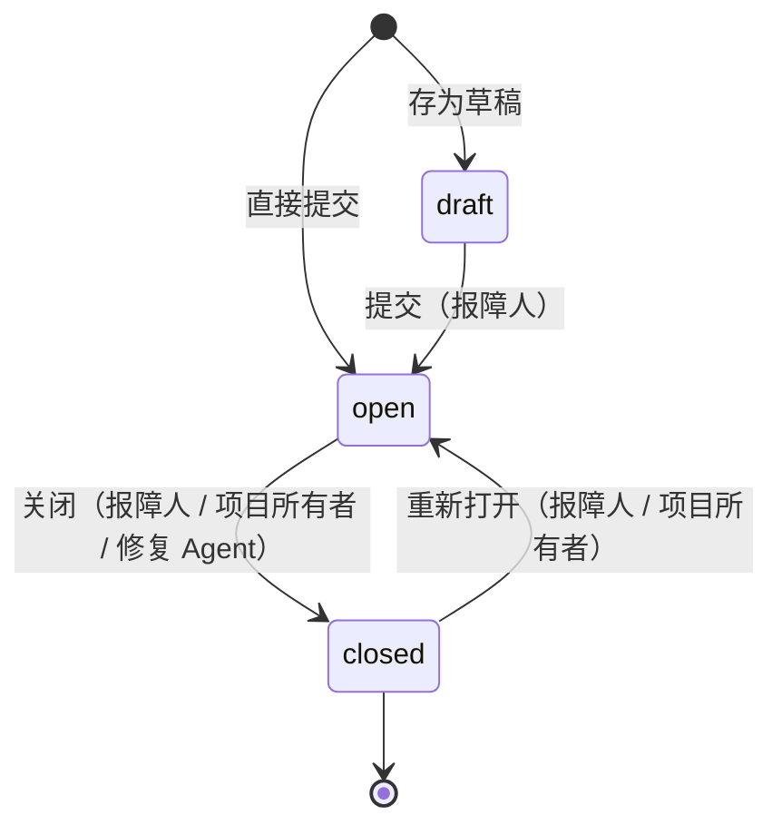

# Tickets 产品设计

**结论：一张工单有两半。报障的一半由报障人自己的 Agent 补齐现场，修复的一半由项目所有者的 Agent 持续消化队列。Tickets 只负责把两半接起来，并保证两边都只能碰自己那一半。**

## 读者与场景

| 角色 | 在 Tickets 里做什么 | 典型动作 |
| --- | --- | --- |
| 报障人 | 描述现象，让 Agent 补齐现场，提交工单 | 新建工单、看证据、补充评论、关单 |
| 项目所有者 | 收工单，接入修复 Agent，决定何时关单 | 建项目、选 Worker、一键接入终极机器 |
| 其他登录用户 | 浏览项目与公开工单，参与讨论 | 评论、提工单 |
| 报障 Agent | 在报障人的机器上只读排查，写回证据 | `ctl`/curl 调 Agent API |
| 修复 Agent | 读队列、诊断、回复、关闭 | `ctl queue/show/comment/close` |

这里的「Agent」不是拟人化的说法：它就是 Cybion 里的一个 Thread，有独立的 Worker、上下文和工具，通过 HTTP 与 Tickets 交互。

## 概念

| 概念 | 定义 |
| --- | --- |
| **项目（Project）** | 一个工单队列，有唯一所有者。任何登录用户都可以在项目下提工单，只有所有者能改设置、接入修复 Agent。 |
| **工单（Ticket）** | 项目内编号递增的一张问题记录，状态是 `draft` / `open` / `closed`。编号在项目内唯一且永不复用。 |
| **报障人（Reporter）** | 创建工单的登录用户。只有报障人能改标题正文、提交草稿；报障人或项目所有者能关单。 |
| **现场调查 Thread** | 报障人的 Cybion Thread：Key 由 Tickets 用报障人的登录授权在 Cybion 铸出，因此 Thread 只属于报障人、跑在报障人的 Worker 上。系统把「工单 + 调查简报 + 一次性令牌」作为第一条 input 投给它。 |
| **修复 Agent** | 项目所有者的 Cybion 终极机器所拥有的 Thread。它靠检查命令轮询队列，不常驻。 |
| **Agent 令牌** | `tk_` 开头的随机串，只存 SHA-256。两种作用域：Reporter（绑定单张工单）与 Resolver（绑定单个项目）。明文只在生成时展示一次。 |
| **现场证据（evidence）** | 一种特殊评论，只有报障 Agent 能写。UI 上单独标记为「现场证据」，修复 Agent 在队列摘要里能直接看到最新一条。 |
| **队列水位** | 每张工单上的两个时间戳：`last_reporter_at` 与 `last_resolver_at`。谁最后说话，就抬高自己那一侧的水位。 |

## 状态机



- **草稿只有报障人可见**：列表、详情、评论、Thread 接口对其他人一律返回 404，队列里也不会出现。
- **提交**会写入一条系统评论，并把 `last_reporter_at` 抬到当前时间，工单立刻进入队列。
- **关闭**会记录是谁关的（用户 / 报障 Agent / 修复 Agent），并写一条系统评论；已关闭的工单冻结标题正文，重开后恢复编辑。
- **重新打开**同样抬高 `last_reporter_at`，让工单重新排队。

## 报障侧协议

1. 报障人点一次「连接 Cybion」即可。浏览器把 Auth Mini 令牌的受众扩到 `cybion.ntnl.io`，服务端拿这枚令牌调 `POST /api/api-keys` 铸一把 `cyb_…` Key，再用 AES-256-GCM 加密存库；`secret.key` 与数据库分开存放、权限 0600。界面不要求粘贴任何密钥，旧的手动 Key 仍作为恢复通道保留。
2. 提交工单时，服务端用**报障人自己的 Key** 调 `POST /v1/threads`，标题形如 `[#12] 充值回调偶发超时`，`external_ref` 指向工单页面。Cybion 按 Key 的 owner 隔离，所以这一步不能用一把公共服务端 Key 代办。
3. Thread 创建成功后，服务端生成一次性 Reporter 令牌，把简报作为第一条 input 投进去。简报包含：项目名称与项目描述、工单原文、调查方向（环境 / 位置 / 现象 / 复现 / 时间线 / 边界）、硬约束（只读、脱敏、结论要有证据、最多问 3 个问题），以及**写回工单的完整 curl 命令**。
4. 报障 Agent 用这条令牌 POST `kind=evidence` 写回四段式报告（现场环境 / 关键证据 / 复现步骤 / 影响范围）。写回会抬高 `last_reporter_at`，修复侧因此知道「有新信息」。
5. 草稿不会自动建 Thread：提交工单时才在后台自动创建。草稿需要报障人在工单页点一次「创建调查 Thread」，它走同一条创建流程，简报会说明「这还是草稿」，调查结果用来把草稿补成可提交的工单。提交时复用同一个 Thread，不会重复创建。
6. Thread 创建或简报投递失败不会阻塞工单提交：错误记在工单上，报障人可以点「重试」补建，或用新令牌重新投递。
7. **评论会唤醒 Thread**：任何登录用户在工单里发表评论，系统都会把评论作为一条新 input 推进这张工单的现场调查 Thread（线程还不存在时先补建），Thread 把评论当作新线索继续查、补证据。工单已关闭时评论只作补充记录，提示词不要求再跑一轮。推进失败只记在 `reporter_thread_error` 上，评论本身不会丢。

## 修复侧协议

1. 项目所有者在项目设置里选一台 Cybion Worker，点「接入终极机器」。服务端生成修复密钥（只存 SHA-256），用同一枚登录令牌调 Cybion `POST /api/machines` 建机器，并记下 `resolver_machine_id` 与机器自带的修复 Thread 链接。
2. 机器执行的检查命令由服务端 `machine.rs` 生成，不需要任何人复制。命令会：
   - 把密钥写到 `~/.tickets/key`（0600），把 `ctl` 助手写到 `~/.tickets/ctl`，因此后续 curl 都引用变量，密钥不会出现在输出里；
   - 调 `GET /api/agent/queue`；
   - 队列为空时**退出 0 且不输出**，终极机器保持沉默；
   - 有工单时打印每张工单的编号、项目、报障人、链接、现象与最新证据，**退出 1**，终极机器据此唤醒修复 Thread。
3. 项目设置里能直接暂停 / 启用、立即运行、断开机器；断开会在 Cybion 删除机器并吊销本项目的修复密钥。
5. 修复 Thread 被唤醒后按提示逐个处理：`ctl show <id>` 读全文，`ctl comment <文件> <id>` 回复，`ctl close <id>` 关单。需要报障人补充信息时提问并保持 Open。
4. 检查命令以 120 秒为默认节奏重复执行；写评论与关单都会抬高 `last_resolver_at`，同一张工单不会反复唤醒机器。

退出码的约定：

| 退出码 | 含义 | 终极机器的行为 |
| --- | --- | --- |
| 0 | 队列空 | 沉默 |
| 1 | 有工单待处理 | 唤醒 Thread，把队列摘要交给它 |
| 2 | 缺少 `jq`、服务不可达、密钥无效 | 同样唤醒 Thread，让它先修环境或报告问题 |

## 队列语义

```
status = 'open'
AND last_reporter_at > last_resolver_at
ORDER BY last_reporter_at ASC
LIMIT 5
```

- **判据是「报障侧最后说话」**：新提交、报障人评论、报障 Agent 写证据都会抬高 `last_reporter_at`；修复 Agent 的任何评论或关单都会抬高 `last_resolver_at`。因此「已回复、等报障人补充」的工单不会反复出现。
- **最久没被处理的先出**（FIFO），避免老工单饿死。
- **一次最多 5 张**，让检查命令的输出保持可读；`total_open` 单独返回项目里所有 Open 工单数，用来判断积压规模。
- 修复 Agent 回复后工单仍在 Open，仍计入 `total_open`，但不再出现在 `pending` 里，直到报障侧再次说话。

## 权限矩阵

| 操作 | 报障人 | 项目所有者 | 其他登录用户 | 报障 Agent | 修复 Agent |
| --- | --- | --- | --- | --- | --- |
| 浏览项目 / 公开工单 | ✓ | ✓ | ✓ | — | — |
| 新建工单 | ✓ | ✓ | ✓ | — | — |
| 查看草稿 | ✓ | — | — | 仅自己那张 | — |
| 修改标题正文 | ✓（未关闭） | — | — | — | — |
| 评论 | ✓ | ✓ | ✓ | ✓（自己那张） | ✓（本项目） |
| 提交草稿 | ✓ | — | — | — | — |
| 关闭 / 重新打开 | ✓ | ✓ | — | ✓（自己那张） | ✓（本项目） |
| 修改项目 / 管理修复密钥 | — | ✓ | — | — | — |
| 读取队列 | — | — | — | — | ✓ |
| 写入现场证据 | — | — | — | ✓ | — |

「—」表示接口直接拒绝（403/404），不是 UI 隐藏。

## 当前的边界

- **唤醒是轮询的**：修复侧靠终极机器按固定间隔执行检查命令，报障侧的写回不会实时推给修复 Thread。间隔越短，延迟越低，代价是更多次空跑。
- **没有抢占**：如果同一个项目的终极机器在多台 Worker 上同时运行，两个修复 Thread 可能同时看到同一张工单。当前靠「先评论再处理」的提示词纪律降低重复劳动，没有服务端租约。
- **没有附件**：证据是 Markdown 文本，日志需要 Agent 摘录关键片段，而不是上传整个文件。
- **Thread 的上下文用量只在打开工单时实时探测**，不落库，因此不能做跨工单的用量统计。

## 验收标准

一张工单从提交到闭环，应该能看到这些事实：

1. 提交后 1 分钟内，工单上出现现场调查 Thread，且 Thread 的 owner 是报障人。
2. 报障 Agent 写回的证据带「现场证据」标记，修复侧的队列摘要能看到它。
3. 修复 Agent 的回复出现在同一条时间线上，作者标记为「修复 Agent · 项目名」。
4. 关单后队列不再返回这张工单，`total_open` 减一。
5. 关单者、关闭时间与系统评论一致，重开后 `closed_at` 归零。
