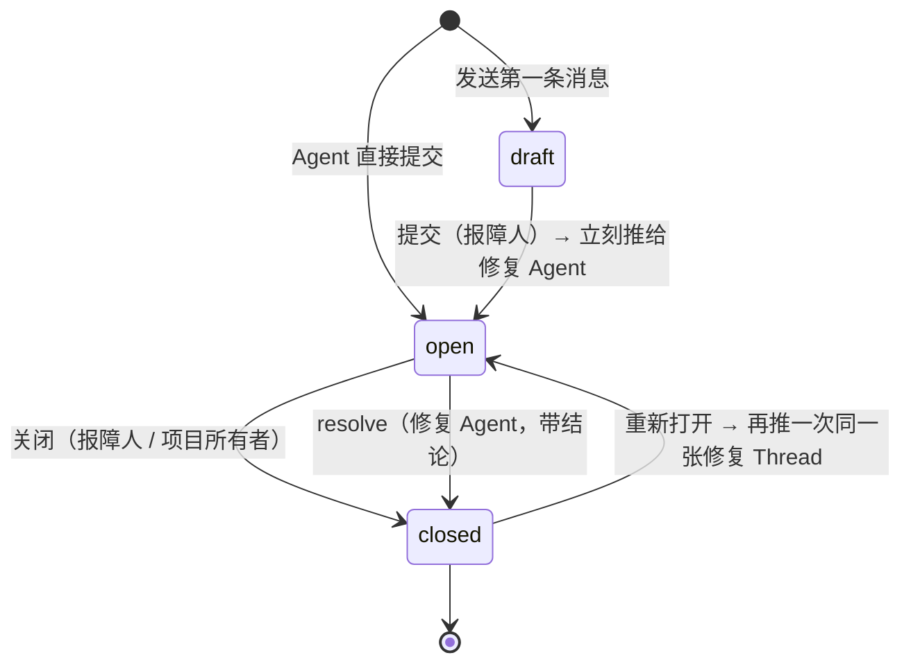

# Tickets 产品设计

**结论：一张工单有两半。报障的一半由报障人自己的 Agent 补齐现场，修复的一半由项目所有者的 Agent 当场接手。Tickets 只做一件事——在报障人点提交的那一刻，把工单连同证据推到修复 Agent 手里，并保证两边都只能碰自己那一半。**

## 读者与场景

| 角色 | 在 Tickets 里做什么 | 典型动作 |
| --- | --- | --- |
| 报障人 | 描述现象，让 Agent 补齐现场，提交工单 | 新建工单、和 Agent 对话、提交、关单 / 重开 |
| 项目所有者 | 收工单，连上自己的 Cybion，决定何时关单 | 建项目、连接 Cybion、管理成员、重开或关单 |
| 其他登录用户 | 在公开项目里浏览与提工单 | 提工单、看结论 |
| 报障 Agent | 在报障人的机器上只读排查，写回证据 | 调 Agent API 写 `evidence` |
| 修复 Agent | 拿到派单，诊断、修复、写结论并关单 | 调 Agent API 读工单、`resolve` |

这里的「Agent」不是拟人化的说法：它就是 Cybion 里的一个 Thread，有独立的机器、上下文和工具，通过 HTTP 与 Tickets 交互。

## 概念

| 概念 | 定义 |
| --- | --- |
| **项目（Project）** | 一个工单队列，有唯一所有者和可见性（`public` / `private`）。私有项目只有所有者和授权成员能看见、提工单；公开项目对所有登录用户开放。只有所有者能改设置、管理成员。 |
| **工单（Ticket）** | 项目内编号递增的一张问题记录，状态是 `draft` / `open` / `closed`。编号在项目内唯一且永不复用。 |
| **报障人（Reporter）** | 创建工单的登录用户。只有报障人能改标题正文、提交草稿；报障人或项目所有者能关单、重开。 |
| **现场调查 Thread** | 报障人的 Cybion Thread：Key 由 Tickets 用报障人的登录授权在 Cybion 铸出，因此 Thread 只属于报障人、跑在报障人的机器上。系统先把「工单 + 调查简报 + 一次性令牌」写成折叠的上下文，再用报障人的一句开场话启动调查。 |
| **修复 Thread** | 项目所有者的 Cybion Thread，**提交时现场创建**。Tickets 用所有者的 Key 建 Thread，把「工单 + 现场证据 + 一次性令牌 + 关闭接口」一次推给它。 |
| **Agent 令牌** | `tk_` 开头的随机串，只存 SHA-256。两种作用域，都只绑定一张工单：Reporter（写证据）与 Resolver（写结论并关单）。明文只出现在那张 Thread 的简报里，界面上不展示。 |
| **现场证据（evidence）** | 报障 Agent 写回的四段式报告（现场环境 / 关键证据 / 复现步骤 / 影响范围）。重复写回会覆盖，工单上永远只有最新一份。 |
| **处理结论（resolution）** | 修复 Agent 写回的四段式结论（根因 / 改了什么 / 怎么验证 / 残留风险）。写结论的同一次调用把工单关闭，因此「已关闭」的工单一定有结论。 |

工单没有评论区，也没有「队列水位」：两侧的推进只有三种事件——提交、重新打开、报障 Agent 补写证据。它们都是**推送**，不是轮询。

## 状态机

- **草稿只有报障人可见**：列表、详情、Thread、派发接口对其他人一律返回 404。
- **提交是一次派单**：状态变为 `open`，后台用项目所有者的 Key 创建修复 Thread、写入派单上下文并发一条开场消息。派发失败不会阻塞提交，只把原因记在工单上（`resolver_thread_error`），由所有者修好之后重试。
- **关闭要留痕**：谁关的（用户 / 修复 Agent）与时间都落库，修复 Agent 关闭时必须同时写下处理结论。
- **重新打开**把工单推回同一张修复 Thread（历史就是上下文，只需说明「上次结论是什么、请重新核实」），修复 Thread 不存在时才重新派发。

## 报障侧协议

### 创建工单就是开始一段对话

- 项目页的「新建工单」直接进入一个对话页：一个输入框，没有标题栏，也没有正文栏。
- 报障人发出的第一条消息同时成为工单正文与标题：标题取第一条非空行，折叠空白后截到 80 字；正文保存完整消息。
- 服务端在同一次请求里创建草稿，工单页打开后立即建立 Cybion Thread，不需要再点「创建调查 Thread」。
- 草稿页同样先显示正文，下面是现场调查面板：Agent 的推理、工具调用与回复都在面板里，提交后正文留在原位，面板继续保留调查过程。正文只出现一次，不会在面板里再复制一遍。
- 标题以 Thread 为准：Thread 在 Cybion 里被改名后，下一次读取会把新名字同步回工单。Tickets 自己加的 `[#12] ` 前缀会在同步时去掉。

### 连接与建 Thread

1. 报障人点一次「连接 Cybion」即可。浏览器把 Auth Mini 令牌的受众扩到 `cybion.ntnl.io`，服务端拿这枚令牌调 `POST /api/api-keys` 铸一把 `cyb_…` Key，再用 AES-256-GCM 加密存库；`secret.key` 与数据库分开存放、权限 0600。界面不要求粘贴任何密钥。
2. 建立 Thread 时，服务端用**报障人自己的 Key** 调 `POST /v1/threads`，标题形如 `[#12] 充值回调偶发超时`，`external_ref` 指向工单页面。Cybion 按 Key 的 owner 隔离，所以这一步不能用一把公共服务端 Key 代办。
3. Thread 创建成功后，服务端生成一次性 Reporter 令牌，把简报写进 Thread 的上下文（Cybion 的 `context` 接口：存成 activity、回放为 developer 消息，对话里折叠），再用报障人的一句开场话触发调查。简报包含：项目名称与项目描述、工单原文、调查方向（环境 / 位置 / 现象 / 复现 / 时间线 / 边界）、硬约束（只读、脱敏、结论要有证据、最多问 3 个问题），以及**写回证据的完整 curl 命令**。
4. 报障 Agent 用这条令牌 `POST /api/agent/tickets/{id}/evidence` 写回四段式报告。工单进入 `open` 之后补写证据，会顺带把新证据推进修复 Thread。
5. Thread 创建、简报写入或开场消息失败不会阻塞工单提交：错误记在工单上，报障人可以在工单页重试补建。简报没写进上下文时不会发开场消息，避免 Agent 在没有工单信息的情况下开跑。

### 现场调查就是对话

- 页面按 `after` 游标增量读取 Thread 历史，同时每 800ms 读取还在生成的回复；消息、工具调用与工具输出按顺序出现在工单页里。
- 报障人在面板里输入的消息，用**自己的 Auth Mini 令牌**直接写进 Thread，Agent 在同一轮里回答。
- 简报走 Cybion 的上下文接口，作为 developer 消息折叠在对话里；面板里的气泡只有报障人自己的话。
- 这个面板只有报障人能看：Thread 跑在报障人的机器上，属于报障人。
- 人类确认的方式是**提交草稿**（或关闭工单）；提交后工单立刻进入修复侧。

## 修复侧协议：提交即派单

1. 唯一的准备动作是**项目所有者连接自己的 Cybion**。选中 Worker、配置检查间隔、写意图这些都不存在：修复 Thread 跑在所有者账号的机器上，由 Cybion 自己决定用哪台设备。
2. 报障人提交时，服务端用**所有者的 Key** 调 `POST /v1/threads`（标题与 `external_ref` 同工单），接着把派单简报写进上下文、再发一条开场消息启动修复。简报包含：
   - 工单（项目、标题、报障人、页面链接、现象全文）与现场证据全文；
   - 设备指引：先 `cybion_list_workers` 挑一台在线的设备，之后所有 bash / 文件工具都带那台设备的 `worker_id`——**设备选择不需要问人**；
   - 结论接口的完整 curl 命令与一次性 Resolver 令牌；
   - 硬约束：只读核实后再动手、结论必须有命令与输出支撑、**没有人会在线回答你**、修不了也要写清「未修复 + 原因 + 建议」并关闭。
3. 修复 Agent 用令牌 `POST /api/agent/tickets/{id}/resolve`，一次调用完成「写结论 + 关单」。结论为空会被拒绝：工单不会无声地关闭。
4. 之后两种事件会再推同一条 Thread：
   - 工单被**重新打开**：附上上一次的结论，要求重新核实；
   - 报障 Agent 在 `open` 工单上**补写了新证据**：附上新证据，要求重新评估。
5. 派发失败（所有者没连 Cybion、Cybion 不可达）只记在工单上；所有者连上之后在工单页点「重新派发」即可，工单本身不会因此变成草稿或丢失。

## 项目可见性

项目分两种可见性，由所有者随时切换：

- **私有（新项目默认）**：只有所有者和 `project_grants` 里的授权成员能看到项目、浏览与提交工单。其他登录用户访问项目或它的任何工单都得到 404，不暴露项目是否存在。
- **公开**：所有登录用户都能看到项目、浏览工单、提交新工单。

补充约定：

- 存量项目在升级时迁移为公开，保持它们此前「所有人可见」的行为。
- 授权表只授予「能看见并参与」；修改项目、管理成员、重新派发始终只属于项目所有者。
- 成员由所有者用 Linkit 用户选择器按用户名或 UUID 挑选；库里只存 `user_id`，不要求对方先登录过 Tickets。
- **修复侧恒等于项目所有者**：把项目改成私有不会改变修复 Thread 的归属，它仍然用所有者的 Key 创建。
- 项目改为私有后，未获授权的报障人连同自己此前提交的工单一起失去访问权；这是所有者的显式选择。

## 权限矩阵

| 操作 | 报障人 | 项目所有者 | 授权成员 | 其他登录用户（公开项目） | 报障 Agent | 修复 Agent |
| --- | --- | --- | --- | --- | --- | --- |
| 浏览项目 / 工单 | ✓ | ✓ | ✓ | ✓ | — | — |
| 新建工单 | ✓ | ✓ | ✓ | ✓ | — | — |
| 查看草稿 | ✓ | — | — | — | 仅自己那张 | — |
| 修改标题正文 | ✓（未关闭） | — | — | — | — | — |
| 提交草稿 | ✓ | — | — | — | — | — |
| 关闭 / 重新打开 | ✓ | ✓ | — | — | — | ✓（只能关自己那张） |
| 重新派发 | — | ✓ | — | — | — | — |
| 修改项目 / 管理成员 | — | ✓ | — | — | — | — |
| 读取工单 | — | — | — | — | ✓（自己那张） | ✓（自己那张） |
| 写入现场证据 | — | — | — | — | ✓ | — |
| 写入处理结论并关单 | — | — | — | — | — | ✓ |

「—」表示接口直接拒绝（403/404），不是 UI 隐藏。

## 当前的边界

- **派发是尽力而为**：Cybion 不可达时工单停在「未派发」，靠所有者在工单页重试；没有后台重试队列。
- **修复 Thread 不设租约**：同一张工单只会有一张修复 Thread，但如果所有者手上有多个客户端同时在另一张 Thread 里操作同一张工单，服务端不做抢占。
- **没有附件**：证据是 Markdown 文本，日志需要 Agent 摘录关键片段，而不是上传整个文件。
- **Thread 的上下文用量只在打开工单时实时探测**，不落库，因此不能做跨工单的用量统计。

## 验收标准

一张工单从提交到闭环，应该能看到这些事实：

1. 提交后 1 分钟内，工单上出现现场调查 Thread，且 Thread 的 owner 是报障人。
2. 提交的同一时刻，项目所有者的账号下出现一张修复 Thread，它拿到的简报里有工单全文、现场证据与结论接口。
3. 报障 Agent 写回的证据出现在工单的「现场证据」区，重复写回只有最新一份。
4. 修复 Agent 调用 `resolve` 后，工单状态变为 `closed`，「处理结论」区显示它的结论，`closed_by_kind` 是 `resolver_agent`。
5. 重新打开后工单回到 `open`，同一张修复 Thread 收到一条新的 input；`closed_at` 归零。
6. 派发失败时，工单页显示失败原因与「重新派发」按钮，工单本身仍然是 `open`。
