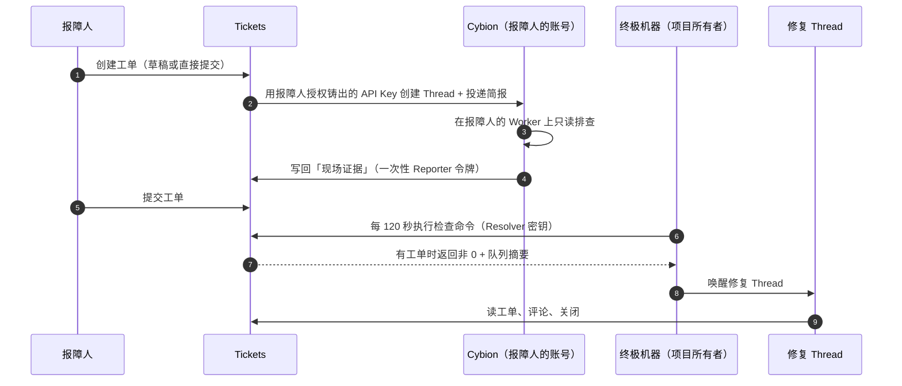
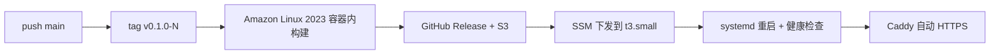

# Tickets

**为 AI Agent 设计的工单系统。** 报障侧的 Agent 在报障人自己的机器上查清现场，修复侧的 Agent 在项目队列上持续监听，两边都通过 HTTP API 说话，人只需要看结论。

- 报障人写一句「哪里不对」就够了：Cybion Thread 会用报障人自己的账号补齐环境、日志、复现步骤，写回「现场证据」。
- 项目所有者在项目设置里挑一台 Worker，Tickets 直接在 Cybion 建好终极机器：队列里有工单才唤醒修复 Thread，没工单就保持沉默。登录令牌的受众包含 `cybion.ntnl.io`，所以密钥与机器都由后台代办，不需要任何粘贴。
- 单个可执行文件内嵌前端，SQLite 存数据，不需要容器、不需要环境变量。

线上实例：<https://tickets.ntnl.io>（Auth Mini 登录）。

## 两条泳道



- 左侧由**报障人自己的 Cybion 账号**驱动，所以 Thread 只属于报障人，也只有报障人能打开。
- 右侧由**项目所有者的终极机器**驱动，检查命令是幂等的：队列空退出 0，有工单退出 1。
- 两侧的权限由两种 `tk_` 开头的 Agent 令牌限定：Reporter 只能碰创建它的那张工单，Resolver 只能碰自己那个项目。

产品语义见 [PRODUCT.md](PRODUCT.md)，实现与部署见 [DESIGN.md](DESIGN.md)。

## 本地开发

需要 Rust 1.93、Node 24+、pnpm 10。

```bash
# 1. 后端：--dev-user 关闭 Auth Mini 校验，并把所有请求视为同一个用户
cargo run -- \
  --data-dir /tmp/tickets-dev \
  --port 8080 \
  --public-base-url http://127.0.0.1:8080 \
  --dev-user 031a393d-8a0a-4ca0-8cb1-313e0d71dfa9

# 2. 前端：Vite 把 /api 代理到 8080
cd web
pnpm install
VITE_DEV_USER=1 pnpm dev
```

打开 <http://127.0.0.1:5173>。`VITE_DEV_USER` 只是让前端跳过 Auth Mini 登录，**具体是谁由后端的 `--dev-user` 决定**；换用户就换参数重启后端。

只在 8080 上预览内嵌版本（构建产物会被 `rust-embed` 打进二进制）：

```bash
cd web && pnpm build && cd ..
cargo run -- --data-dir /tmp/tickets-dev --port 8080 --public-base-url http://127.0.0.1:8080 --dev-user <uid>
```

## 运行参数

| 参数 | 默认值 | 说明 |
| --- | --- | --- |
| `--listen host:port` | `0.0.0.0:8080` | 监听地址 |
| `--port n` | — | 只改端口的快捷方式 |
| `--data-dir path` | `./data` | 数据库与 `secret.key` 所在目录 |
| `--public-base-url url` | 数据库中的值或 `https://tickets.ntnl.io` | 写进简报与队列的对外地址 |
| `--dev-user <subject>` | 无 | 关闭 Auth Mini，仅限本地 |

部署级的地址保存在 SQLite 的 `settings` 表里，启动时读取一次：

| key | 默认值 |
| --- | --- |
| `auth_base_url` | `https://auth.ntnl.io` |
| `linkit_base_url` | `https://linkit.ntnl.io` |
| `cybion_base_url` | `https://cybion.ntnl.io` |
| `public_base_url` | `https://tickets.ntnl.io` |

```bash
sqlite3 /tmp/tickets-dev/tickets.db \
  "INSERT INTO settings(key,value) VALUES('cybion_base_url','https://cybion.example.com') \
   ON CONFLICT(key) DO UPDATE SET value=excluded.value"
```

## HTTP API

浏览器接口由 Auth Mini 保护，`Authorization: Bearer <access token>`；Agent 接口由 Agent 令牌保护，`Authorization: Bearer tk_…`。两条路由空间互不相通。

浏览器侧：

| 方法 | 路径 | 说明 |
| --- | --- | --- |
| GET | `/api/health`、`/api/meta` | 公开：健康检查与服务地址 |
| GET | `/api/me`、`/api/me/tickets` | 当前用户与其工单 |
| GET/PUT/DELETE | `/api/account/cybion` | 连接 / 断开报障人的 Cybion 账号（PUT 自动铸 Key） |
| GET | `/api/cybion/workers` | 当前账号可用的 Cybion Worker |
| GET/POST/PATCH/DELETE | `/api/projects/{id}/resolver` | 查看 / 接入 / 暂停或启用 / 断开终极机器（仅所有者） |
| POST | `/api/projects/{id}/resolver/run` | 让终极机器立即跑一次 |
| GET/POST | `/api/projects` | 项目列表 / 新建 |
| GET/PATCH | `/api/projects/{id}` | 项目详情 / 修改（仅所有者） |
| POST/DELETE | `/api/projects/{id}/resolver-key` | 手动生成 / 吊销修复密钥（仅所有者；界面已改用 `/resolver`） |
| GET/POST | `/api/projects/{id}/tickets` | 工单列表（`?status=open\|closed\|draft\|all`）/ 新建 |
| GET/PATCH | `/api/tickets/{id}` | 工单详情 / 修改标题正文（仅报障人） |
| POST | `/api/tickets/{id}/submit`、`close`、`reopen` | 状态流转 |
| POST | `/api/tickets/{id}/comments` | 评论 |
| GET/POST | `/api/tickets/{id}/thread` | 查看 / 补建现场调查 Thread |

Agent 侧：

| 方法 | 路径 | 作用域 |
| --- | --- | --- |
| GET | `/api/agent/whoami` | 两者 |
| GET | `/api/agent/queue` | Resolver |
| GET | `/api/agent/tickets/{id}` | 两者，但只能读自己作用域内的工单 |
| POST | `/api/agent/tickets/{id}/comments` | 两者；`kind=evidence` 仅 Reporter |
| POST | `/api/agent/tickets/{id}/close` | 两者 |

## 测试

```bash
cargo test                      # 单元 + 集成：真路由 + 假 Cybion
cd web && pnpm test             # i18n、命令生成器（会真的执行生成的 bash）
cd web && pnpm run check        # 测试 + 类型 + 构建
```

## 部署

发布完全由 GitHub Actions 完成，服务器上以 systemd + Caddy 运行，数据目录 `/opt/tickets/data` 不随发布覆盖。



- `.github/workflows/pr-check.yml`：PR 的测试、格式、lint 与构建门禁。
- `.github/workflows/release.yml`：合并后打 tag、构建、上传 S3、SSM 部署，失败自动回滚。
- `deploy/bootstrap.sh`：一次性主机初始化（用户、目录、Caddy）。
- `deploy/remote-deploy.sh`：实例上的发布脚本（校验 sha256、同步 unit/Caddyfile、重启、健康检查）。

重新部署一个历史版本：手动触发 `release` 工作流，填 `deploy_tag`。

## 目录结构

```
src/            后端：Axum 路由、SQLite、Auth Mini、Cybion 客户端、简报生成
web/            前端：React + Vite + Tailwind + shadcn + @zccz14/ux
tests/          集成测试：真路由 + 假 Cybion 服务
deploy/         主机初始化、systemd 单元、Caddyfile、实例发布脚本
.github/        PR 检查与发布工作流
```

## License

MIT
